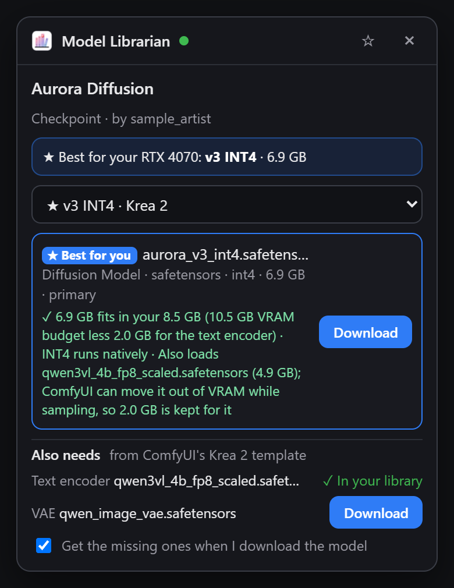
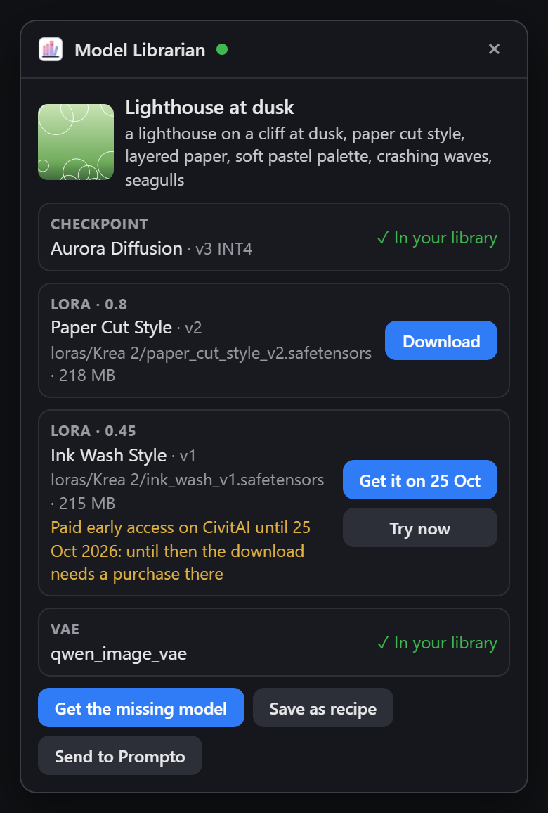
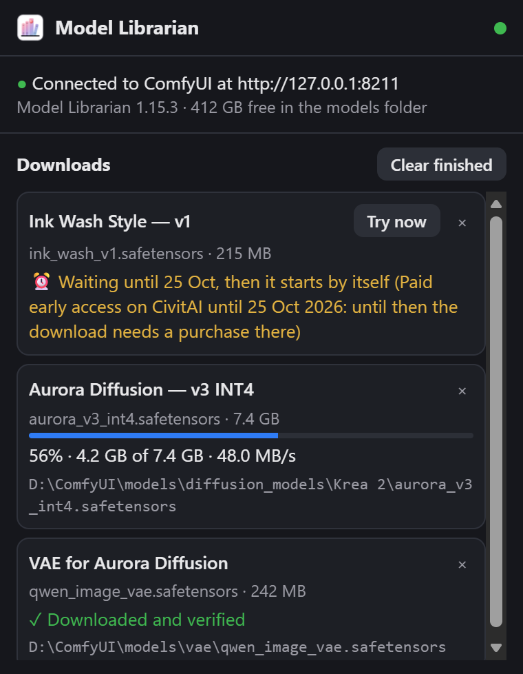
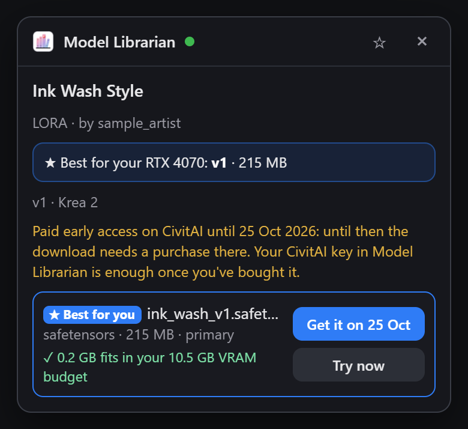
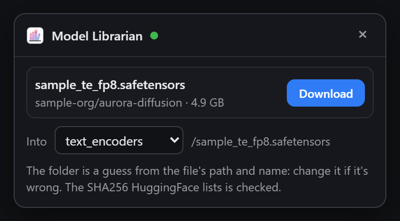
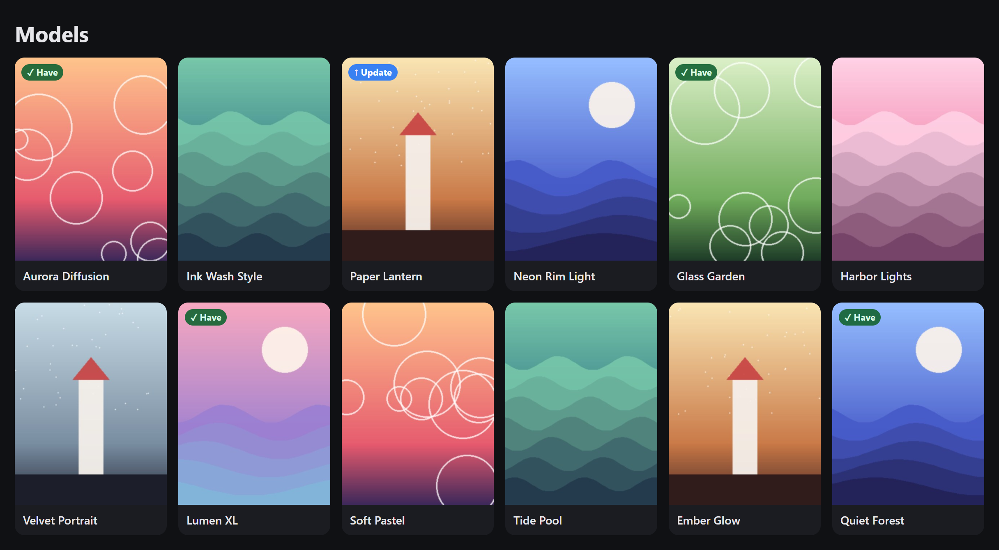
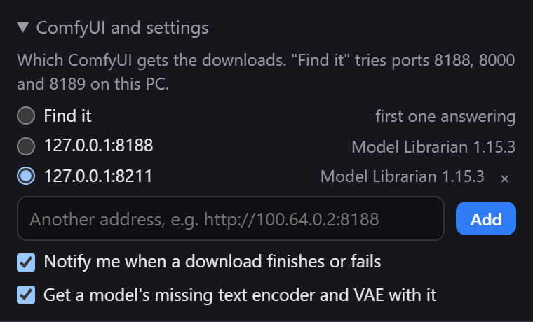

<div align="center">
  
  <h1>Model Librarian for Chrome</h1>
  <p><b>One click on CivitAI puts the model in the right ComfyUI folder: sorted, verified and tracked by Model Librarian.</b></p>
  <p>
    <a href="LICENSE"></a>
    <a href="https://github.com/EY4O/Chrome-Model-librarian/commits/main"></a>
    <a href="https://ko-fi.com/looneth"></a>
  </p>
</div>

A Chrome and Edge extension for people who use [Model Librarian](https://github.com/EY4O/ComfyUI-Model-Librarian) in ComfyUI. It puts a **Download with Model Librarian** panel on every CivitAI model page. Model Librarian does the download inside ComfyUI, the same way its Recipes tab does: the right folder for the model's type, a subfolder for its base model, SHA256 check, resume, metadata and preview. ComfyUI doesn't have to be open when you click: downloads wait in the extension and start when it is.

<p align="center"></p>

> **⚠ Needs Model Librarian 1.11.0 or newer**; 1.15.0 for everything here (image pages, badges, HuggingFace and CivArchive). in the ComfyUI you download into. CivitAI keys stay in Model Librarian (**Settings**); the extension never sees them.

## ✨ Key Features

- ⬇️ **One click per file** — on CivitAI model pages (every version and file: full, pruned, fp16, a bundled VAE), HuggingFace file pages and CivArchive pages (live copies of models removed from CivitAI).
- ★ **Best file for your PC** — rates every file against your GPU, its VRAM (keeping room for the text encoder) and the formats your ComfyUI runs at full speed (FP8, NVFP4, INT8/INT4, GGUF), and says why the others are slower.
- 🧩 **Everything it needs** — a diffusion model's text encoder and VAE, from ComfyUI's own workflow templates (official links): marked when you have them, fetched with the model if you like.
- 🖼️ **Every model an image used** — on a CivitAI image or post, the checkpoint and every LoRA it used, in one click; saved as a recipe in Model Librarian or sent to Prompto.
- ✅ **Knows what you have** — **✓ Have** and **↑ Update** badges on CivitAI's model cards, **✓ In your library** in the panel (by version, SHA256 or file name), and nothing downloaded twice. Files land in the right ComfyUI folder, sorted by base model.
- ⏳ **Queue while ComfyUI is closed** — clicks wait in the extension and start when ComfyUI is reachable; the popup shows progress, and a notification says when each download is done.
- 📚 **Collections and save for later** — get every missing model of a CivitAI collection (the best file of each), or star a model to come back to.
- 🖥️ **Works with Comfy Desktop, and several ComfyUIs** — talks to ComfyUI directly (no browser tab needed); pick which ComfyUI gets the downloads, including one on another PC (e.g. over Tailscale).
- 🔒 **Keys stay home** — CivitAI and HuggingFace keys live in Model Librarian; the extension never sees them.

## 📸 Screenshots

| | |
|:---:|:---:|
| <br>**Every model an image used** — in your library, to download, or free on a later day | <br>**Popup** — progress, finished downloads, and the ones waiting for their day |
| <br>**Paid for now?** — get it on the day it's free, or try now if you've bought it | <br>**HuggingFace** — into the folder guessed from the file's path |

<p align="center"><br><b>Badges</b> — models you have, and ones with a newer version, marked on every listing</p>

<p align="center"><br><b>Several ComfyUIs</b> — pick which one gets the downloads</p>

<sub>Screenshots use staged pages and sample data (`tools/media/make_media.py`), not real CivitAI or HuggingFace content.</sub>

## 📦 Installation

### Load unpacked

1. Download this repository (**Code → Download ZIP**, then unzip) or clone it:
   ```bash
   git clone https://github.com/EY4O/Chrome-Model-librarian.git
   ```
2. Open `chrome://extensions` (or `edge://extensions`), turn on **Developer mode**.
3. Click **Load unpacked** and pick the folder that has `manifest.json`.
4. Pin **Model Librarian** to the toolbar.

To update: pull or unzip the new version over the old one, then press the reload arrow on the extension's card.

## 🚀 Getting Started

1. Make sure Model Librarian 1.15.0+ is installed in your ComfyUI (ComfyUI-Manager or the Comfy Registry).
2. Start ComfyUI. Click the toolbar icon: it should say **Connected to ComfyUI**. It looks on ports 8188, 8000 (Comfy Desktop) and 8189 by itself; another address goes under **ComfyUI and settings**.
3. Open a model on CivitAI and press **Download with Model Librarian** at the bottom right.
4. Pick the version (★ marks the best one for your PC), then **Download** next to the file you want. On an image page, **Get its models with Model Librarian** fetches everything the image used.
5. Follow it in the popup; when it's done the model is in ComfyUI's lists after a refresh.

## 📖 How It Works

<details>
<summary><b>🔌 Talking to ComfyUI</b></summary>

ComfyUI refuses requests from other origins (like an extension) when it listens on 127.0.0.1 or localhost, unless it was started with `--enable-cors-header`. The extension's own requests to those addresses are sent without an `Origin` header (a `declarativeNetRequest` rule that only applies to requests the extension itself makes), so they get through without changing how ComfyUI starts and without a ComfyUI tab, which matters for Comfy Desktop's own window. If ComfyUI still refuses, the request is run inside an open ComfyUI tab, where it's same-origin.

Websites can't use this: the rule only matches requests from this extension, and everything else still meets ComfyUI's own check.
</details>

<details>
<summary><b>★ Which file suits your PC</b></summary>

Model Librarian reports what decides it: the GPU and its VRAM (minus the headroom set in its **Settings**), which quantized formats this ComfyUI runs at full speed on that GPU (ComfyUI's own checks), and whether the GGUF and Nunchaku loaders are installed. The extension reads each file's format from its name (CivitAI's format tags are often wrong), then rates it:

- **✓** fits in the VRAM budget and runs natively;
- **◐** works, but slower: part of it runs from RAM, or the format isn't native on this GPU (NVFP4 and MXFP8 need an RTX 50-series, FP8 an RTX 40-series);
- **✗** can't load here (e.g. a GGUF file without ComfyUI-GGUF).

A standalone diffusion model (a "Diffusion Model" or GGUF file, not an all-in-one checkpoint) also loads a text encoder. ComfyUI can move the encoder out of VRAM while sampling, so its whole size isn't held back, but about 2 GB (or the encoder's own size, if smaller) is kept free for it, as model makers advise; each file says so and names the encoder (Krea 2's is `qwen3vl_4b_fp8_scaled`, 4.9 GB).

The **★ Best for your GPU** pick is the file with the most precision that still fits and runs fast; among equals, the newest version. Text encoders and VAEs are never picked. In the version list, ★ marks the pick and ✓ / ◐ / ✗ the best file of each version.
</details>

<details>
<summary><b>🧩 Text encoders and VAEs</b></summary>

A "Diffusion Model" file (or a GGUF) is only the core of the model: ComfyUI also loads a text encoder and a VAE for it. Model Librarian reads ComfyUI's own workflow templates, which list the files each official workflow loads with their folder and download link, picks the templates of the model's base family (Krea 2, Flux, Wan, Qwen, Z-Image, ...) and among those the one whose model file is most like yours, and shows its text encoders and VAE under **Also needs**:

- **✓ In your library** when you have the file, in any subfolder;
- **≈ you have …** when you have the same encoder in another precision (e.g. `t5xxl_fp8` instead of `t5xxl_fp16`);
- **Download** otherwise (or **Get N** for all of them): Model Librarian downloads from the template's official link, with the SHA256 from HuggingFace.

Only files on that list can be downloaded this way, and nothing is suggested for families without a template (all-in-one checkpoints like SDXL already include theirs).
</details>

<details>
<summary><b>🖼️ Images, posts and collections</b></summary>

On a CivitAI image page, **Get its models with Model Librarian** sends the page's link to Model Librarian, which reads the image's generation data from CivitAI (the same reader as its Recipes tab) and plans every model it names: the checkpoint or diffusion model, the LoRAs (with their strengths), the VAE. Each shows **✓ In your library**, **Download**, or why it can't be downloaded (removed, early access). **Get all missing** queues the rest; **Save as recipe** keeps it in Model Librarian's Recipes; **Send to Prompto** goes to Prompto's inbox when ComfyUI-Prompto is installed. On a post, pick the image first.

On a collection page, the panel lists the models whose cards are on the page and **Get all N missing** queues the best file of each for your PC (or the newest version's main file). Only cards that are loaded count, so scroll down first for long collections.
</details>

<details>
<summary><b>✅ Badges</b></summary>

Every model card on CivitAI (home, search, a user's page, a collection) is checked against your library by model id: **✓ Have** when Model Librarian has a file of that model, **↑ Update** when a newer version of one you have is out (from Model Librarian's update check). The answers are cached for two minutes.
</details>

<details>
<summary><b>🤗 HuggingFace and CivArchive</b></summary>

- **HuggingFace**: on a model file's page (`.safetensors`, `.gguf`, `.ckpt`, …), pick the ComfyUI folder (it's guessed from the path, e.g. Comfy-Org's `split_files/vae/`, and the name) and download; the SHA256 HuggingFace lists is checked. A file with the same name in that folder counts as yours.
- **CivArchive**: every file the page links by SHA256 is looked up: already yours, or its live copies (CivitAI re-uploads, HuggingFace mirrors) planned into the right folder by Model Librarian, and copies on other hosts as links. On a model page, CivitAI's own download is offered first (CivArchive uses CivitAI's ids).
</details>

<details>
<summary><b>🖥️ Several ComfyUIs and notifications</b></summary>

**ComfyUI and settings** in the popup lists every ComfyUI answering on ports 8188, 8000 and 8189 (with its Model Librarian version) and the addresses you added; choose which one gets the downloads, or **Find it** to use the first one answering. A notification appears when a download finishes or fails (switch it off there too), and **Get a model's missing text encoder and VAE with it** decides whether those come along automatically.
</details>

<details>
<summary><b>⏳ The queue</b></summary>

Each click is stored in the extension first (`chrome.storage`), so nothing is lost if ComfyUI is closed, restarts or the browser restarts. The queue is sent when a Model Librarian answers: every 30 seconds, when a ComfyUI tab finishes loading, and right after a click. Once Model Librarian has a download, the extension follows its progress every 2 seconds. If CivitAI fails for a moment, the item is tried again a few times before it's marked as failed; failed items have **Retry**.

A version that's paid or early access for now (CivitAI says until when) offers **Get it on <date>**: it waits in the downloads list (**⏰ Waiting until …** in the popup) and starts by itself once that day has passed, with **Try now** if you've bought it. A download CivitAI refuses for that reason turns into such a wait by itself, and a failed one can be set to **Wait for <date>**.
</details>

<details>
<summary><b>🗂️ Where files go</b></summary>

Model Librarian decides, from CivitAI's details of that version: the folder for the model type (`checkpoints`, `loras`, `embeddings`, `vae`, `controlnet`, `upscale_models`, `animatediff_models`, `hypernetworks`), and for checkpoints, LoRAs and diffusion models a subfolder named for the base model (the names Organize uses). A GGUF "checkpoint" goes to `diffusion_models`, a version's bundled VAE file to `vae`. Workflows, wildcards and training data aren't model files and aren't downloaded. A file that's already there, or already downloading, isn't started again.
</details>

<details>
<summary><b>🔒 Privacy and permissions</b></summary>

- **civitai.com / .green / .red, huggingface.co, civarchive.com** — to show the panel; CivitAI's public API is read for model versions and files.
- **127.0.0.1 / localhost** — to reach Model Librarian in ComfyUI. Another address is asked for when you save it.
- **storage, alarms, notifications** — the queue, the 30-second check and the "downloaded" notices. **scripting** — the fallback through an open ComfyUI tab. **declarativeNetRequestWithHostAccess** — the header rule above.

Nothing is sent anywhere else, and the extension stores no keys.
</details>

---

## 🧪 Development

See [docs/DEVELOPMENT.md](docs/DEVELOPMENT.md).

## 🤝 Contributing

Issues and pull requests are welcome. Please run `node --test` before sending changes.

## 🙏 Credits

- [Model Librarian](https://github.com/EY4O/ComfyUI-Model-Librarian), which does the downloading.
- [Prompto](https://github.com/EY4O/prompto), whose CivitAI and ComfyUI code this started from.
- [CivitAI](https://civitai.com)'s public API.
- Stability Matrix's extension, for the idea.

## ☕ Support

If this saves you a few clicks per model, you can support its development:

[](https://ko-fi.com/looneth)

## 📄 License

[MIT](LICENSE)
