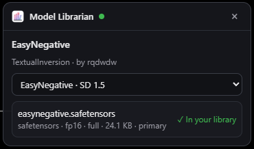
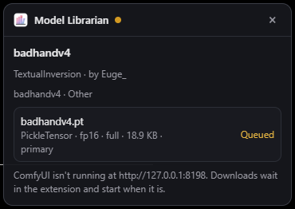

<div align="center">
  
  <h1>Model Librarian for Chrome</h1>
  <p><b>One click on CivitAI puts the model in the right ComfyUI folder: sorted, verified and tracked by Model Librarian.</b></p>
  <p>
    <a href="LICENSE"></a>
    <a href="https://github.com/EY4O/Chrome-Model-librarian/commits/main"></a>
    <a href="https://ko-fi.com/looneth"></a>
  </p>
</div>

A Chrome and Edge extension for people who use [Model Librarian](https://github.com/EY4O/ComfyUI-Model-Librarian) in ComfyUI. It puts a **Download with Model Librarian** panel on every CivitAI model page. Model Librarian does the download inside ComfyUI, the same way its Recipes tab does: the right folder for the model's type, a subfolder for its base model, SHA256 check, resume, metadata and preview. ComfyUI doesn't have to be open when you click: downloads wait in the extension and start when it is.

<p align="center"></p>

> **⚠ Needs Model Librarian 1.11.0 or newer** (1.12.0 for the best-file suggestions, 1.13.0 for the text encoder and VAE) in the ComfyUI you download into. CivitAI keys stay in Model Librarian (**Settings**); the extension never sees them.

## ✨ Key Features

- ⬇️ **One click per file** — every version and file of a model (full, pruned, fp16, a bundled VAE), with sizes.
- ★ **Best file for your PC** — rates every file against your GPU, its VRAM and the formats your ComfyUI runs at full speed (FP8, NVFP4, INT8/INT4, GGUF), marks the best one and says why the others are slower.
- 🗂️ **Lands in the right place** — checkpoints, LoRAs, embeddings, VAEs, ControlNets, upscalers and more go to their ComfyUI folders, sorted by base model like Model Librarian's Organize.
- ⏳ **Queue while ComfyUI is closed** — clicks are kept in the extension and sent the moment ComfyUI is reachable (checked every 30 seconds and whenever a ComfyUI tab opens).
- 🧩 **Everything it needs** — a diffusion model also needs its text encoder and VAE: the panel lists them from ComfyUI's own workflow templates (official links), marks the ones you have, and downloads the rest.
- ✅ **Knows what you have** — files already in your library show **✓ In your library** (by version or by SHA256 under any name), and nothing is downloaded twice.
- 📊 **Progress in the toolbar** — the popup lists every download with progress and speed, and the icon counts what's left.
- 🖥️ **Works with Comfy Desktop** — talks to ComfyUI directly, so no ComfyUI browser tab is needed; a ComfyUI on another PC (e.g. over Tailscale) works too.
- 🔒 **Keys stay home** — CivitAI keys live in Model Librarian, and only Model Librarian talks to CivitAI for downloads.

## 📸 Screenshots

| | |
|:---:|:---:|
|  **Already in your library** — found by version or SHA256 |  **Popup** — connection, queue and progress |
|  **ComfyUI closed?** — the download waits and starts when it runs | |

## 📦 Installation

### Option 1: **Load unpacked** (Recommended for now)

1. Download this repository (**Code → Download ZIP**, then unzip) or clone it:
   ```bash
   git clone https://github.com/EY4O/Chrome-Model-librarian.git
   ```
2. Open `chrome://extensions` (or `edge://extensions`), turn on **Developer mode**.
3. Click **Load unpacked** and pick the folder that has `manifest.json`.
4. Pin **Model Librarian** to the toolbar.

To update: pull or unzip the new version over the old one, then press the reload arrow on the extension's card.

### Option 2: **Chrome Web Store**

Not published yet.

## 🚀 Getting Started

1. Make sure Model Librarian 1.11.0+ is installed in your ComfyUI (ComfyUI-Manager or the Comfy Registry).
2. Start ComfyUI. Click the toolbar icon: it should say **Connected to ComfyUI**. It looks on ports 8188, 8000 (Comfy Desktop) and 8189 by itself; another address goes under **ComfyUI address**.
3. Open a model on CivitAI and press **Download with Model Librarian** at the bottom right.
4. Pick the version, then **Download** next to the file you want.
5. Follow it in the popup; when it's done the model is in ComfyUI's lists after a refresh.

## 📖 How It Works

<details>
<summary><b>🔌 Talking to ComfyUI</b></summary>

ComfyUI refuses requests from other origins (like an extension) when it listens on 127.0.0.1 or localhost, unless it was started with `--enable-cors-header`. The extension's own requests to those addresses are sent without an `Origin` header (a `declarativeNetRequest` rule that only applies to requests the extension itself makes), so they get through without changing how ComfyUI starts and without a ComfyUI tab, which matters for Comfy Desktop's own window. If ComfyUI still refuses, the request is run inside an open ComfyUI tab, where it's same-origin.

Websites can't use this: the rule only matches requests from this extension, and everything else still meets ComfyUI's own check.
</details>

<details>
<summary><b>★ Which file suits your PC</b></summary>

Model Librarian reports what decides it: the GPU and its VRAM (minus the headroom set in its **Settings**), which quantized formats this ComfyUI runs at full speed on that GPU (ComfyUI's own checks), and whether the GGUF and Nunchaku loaders are installed. The extension reads each file's format from its name (CivitAI's format tags are often wrong), then rates it:

- **✓** fits in the VRAM budget and runs natively;
- **◐** works, but slower: part of it runs from RAM, or the format isn't native on this GPU (NVFP4 and MXFP8 need an RTX 50-series, FP8 an RTX 40-series);
- **✗** can't load here (e.g. a GGUF file without ComfyUI-GGUF).

The **★ Best for your GPU** pick is the file with the most precision that still fits and runs fast; among equals, the newest version. Text encoders and VAEs are never picked. In the version list, ★ marks the pick and ✓ / ◐ / ✗ the best file of each version.
</details>

<details>
<summary><b>🧩 Text encoders and VAEs</b></summary>

A "Diffusion Model" file (or a GGUF) is only the core of the model: ComfyUI also loads a text encoder and a VAE for it. Model Librarian reads ComfyUI's own workflow templates, which list the files each official workflow loads with their folder and download link, picks the templates of the model's base family (Krea 2, Flux, Wan, Qwen, Z-Image, ...) and among those the one whose model file is most like yours, and shows its text encoders and VAE under **Also needs**:

- **✓ In your library** when you have the file, in any subfolder;
- **≈ you have …** when you have the same encoder in another precision (e.g. `t5xxl_fp8` instead of `t5xxl_fp16`);
- **Download** otherwise (or **Get N** for all of them): Model Librarian downloads from the template's official link, with the SHA256 from HuggingFace.

Only files on that list can be downloaded this way, and nothing is suggested for families without a template (all-in-one checkpoints like SDXL already include theirs).
</details>

<details>
<summary><b>⏳ The queue</b></summary>

Each click is stored in the extension first (`chrome.storage`), so nothing is lost if ComfyUI is closed, restarts or the browser restarts. The queue is sent when a Model Librarian answers: every 30 seconds, when a ComfyUI tab finishes loading, and right after a click. Once Model Librarian has a download, the extension follows its progress every 2 seconds. If CivitAI fails for a moment, the item is tried again a few times before it's marked as failed; failed items have **Retry**.
</details>

<details>
<summary><b>🗂️ Where files go</b></summary>

Model Librarian decides, from CivitAI's details of that version: the folder for the model type (`checkpoints`, `loras`, `embeddings`, `vae`, `controlnet`, `upscale_models`, `animatediff_models`, `hypernetworks`), and for checkpoints, LoRAs and diffusion models a subfolder named for the base model (the names Organize uses). A GGUF "checkpoint" goes to `diffusion_models`, a version's bundled VAE file to `vae`. Workflows, wildcards and training data aren't model files and aren't downloaded. A file that's already there, or already downloading, isn't started again.
</details>

<details>
<summary><b>🔒 Privacy and permissions</b></summary>

- **civitai.com / .green / .red** — to show the panel and read the model's versions and files from CivitAI's public API.
- **127.0.0.1 / localhost** — to reach Model Librarian in ComfyUI. Another address is asked for when you save it.
- **storage, alarms** — the queue and the 30-second check. **scripting** — the fallback through an open ComfyUI tab. **declarativeNetRequestWithHostAccess** — the header rule above.

Nothing is sent anywhere else, and the extension stores no keys.
</details>

---

## 🧪 Development

See [docs/DEVELOPMENT.md](docs/DEVELOPMENT.md).

## 🤝 Contributing

Issues and pull requests are welcome. Please run `node --test` before sending changes.

## 🙏 Credits

- [Model Librarian](https://github.com/EY4O/ComfyUI-Model-Librarian), which does the downloading.
- [Prompto](https://github.com/EY4O/prompto), whose CivitAI and ComfyUI code this started from.
- [CivitAI](https://civitai.com)'s public API.
- Stability Matrix's extension, for the idea.

## ☕ Support

If this saves you a few clicks per model, you can support its development:

[](https://ko-fi.com/looneth)

## 📄 License

[MIT](LICENSE)
